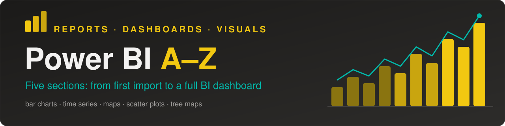
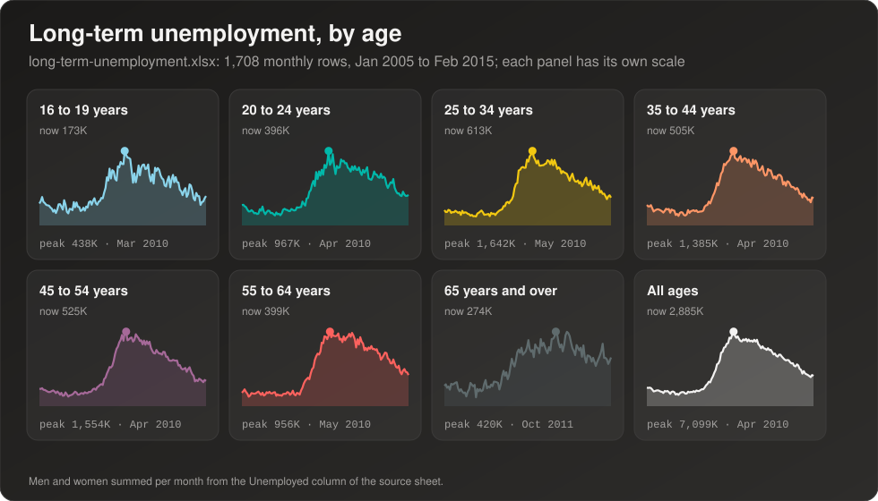
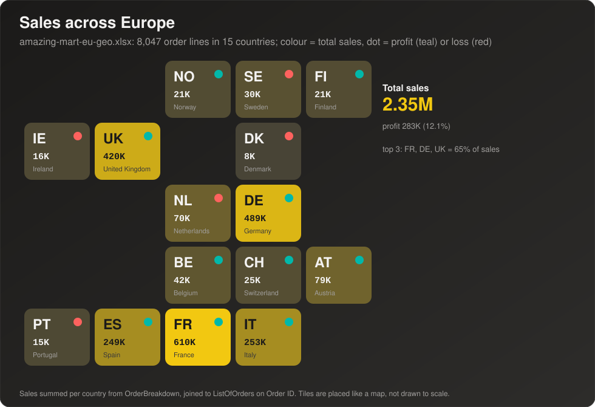
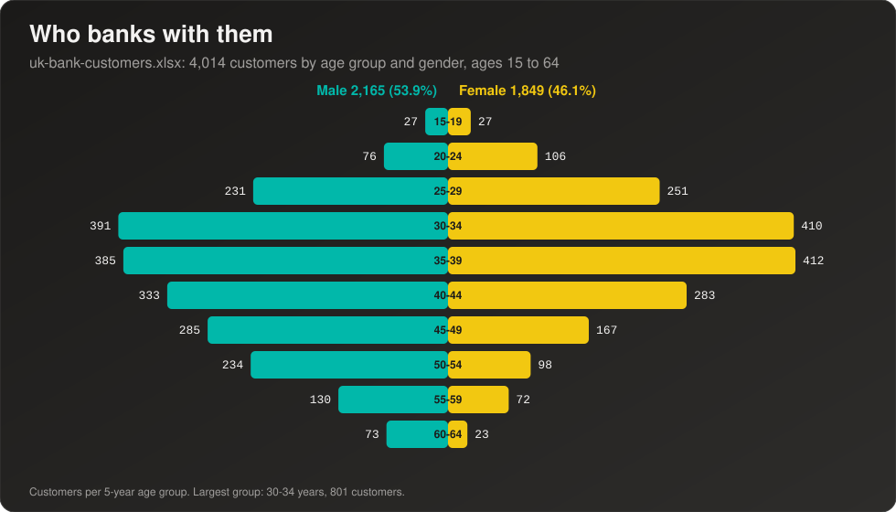

<p align="center">
  
  
  
  
  <a href=".github/workflows/reports-run.yml"></a>
  
</p>

A hands-on course in **Power BI**: five sections that go from your first import to a full BI dashboard, each with its dataset, the finished report (`.pbix`) and PDF screenshots of every page. A script re-computes the numbers printed in the screenshots from the raw data, so the figures in the reports are checked, not just shown.

> *"3,610 values in the report screenshots, re-computed from the source data: 0 differences."*

---

## Course map

| # | Section | Dataset | Report | Screenshot pages |
|:-:|---------|---------|:------:|:----------------:|
| 00 | [Quickstart](00-quickstart/) 🎯 | `hello_powerbi_dataset.csv` | – | – |
| 01 | [Getting Started](01-getting-started/) 📊 | Superstore US 2015 | – | 3 files |
| 02 | [Your First Bar Chart](02-first-bar-chart/) 📈 | Office supplies | ✅ | 4 |
| 03 | [Time Series, Aggregation and Filters](03-time-series-aggregation-filters/) ⏳ | Long-term unemployment | ⚠️ missing | 7 |
| 04 | [Maps and Scatterplots](04-maps-and-scatterplots/) 🗺️ | Amazing Mart EU | ✅ | 7 |
| 05 | [Building a Robust BI Dashboard](05-robust-bi-dashboard/) 🧱 | UK bank customers | ✅ | 7 |

---

## The data tells the story

Pictures drawn from the course datasets (not from the reports): one per section.

### Section 3: unemployment, age group by age group



Every age group peaks in 2010 (65 and over in 2011) and falls afterwards; the total peaked at 7.1 million in April 2010. Section 3 of the course builds exactly these year, quarter, month and day drill-downs, then splits them by age and gender.

### Section 4: sales across Europe



France, Germany and the United Kingdom bring in 65% of the sales. Five of the 15 countries (Denmark, Ireland, the Netherlands, Portugal and Sweden) lost money overall, which a scatter plot of sales against profit, as in Section 4, makes obvious.

### Section 5: who the bank's customers are



More men than women overall (53.9% to 46.1%), but women lead in every age group from 20 to 39 and men from 40 up: the dashboard of Section 5 shows these splits as a pie and as histograms.

---

## Can you trust the numbers in the screenshots?

The manual CI run opens the PDF screenshots, reads the figures printed on them and re-computes each from the source data:

| Report page | What is compared | Result |
|---|---|:-:|
| Section 1: Users sheet | manager of each region | ✅ |
| Section 1: Returns sheet | every returned order id (1,634) | ✅ |
| Section 1: Orders sheet | every Row ID (1,951) | ✅ |
| Section 2: office supplies | region shares and every bar of the sales-rep chart | ✅ |
| Section 5: UK bank | customer count, gender share, job classification share, regions | ✅ |

Sections 3 and 4 show charts whose values are only drawn (axes without printed numbers), so they cannot be compared automatically.

---

## Repository layout

```
Power-BI-A-Z/
├── 00-quickstart/                         # a three-row CSV
├── 01-getting-started/
│   ├── screenshots/                       # PDFs of the report pages
│   └── README.md
├── 02-first-bar-chart/
│   ├── report/  *.pbix                    # the finished Power BI report
│   └── screenshots/
├── 03-time-series-aggregation-filters/
├── 04-maps-and-scatterplots/
├── 05-robust-bi-dashboard/
├── data/                                  # the 5 datasets
├── assets/                                # README banner and charts
└── .github/                               # CI
```

**Why one `main`?** Each section used to live in two branches: one with the data and the report, one with the screenshots (ten branches in all). Now every section is one folder with everything in it, and the history of all ten branches is kept in the commit graph.

---

## How to use

1. Install the free **Power BI Desktop** (Windows).
2. Open a report from `NN-section/report/` (File → Open) to see the finished work, or start from scratch with the dataset in `data/` (*Get data → Excel workbook / Text/CSV*).
3. Compare your pages with the PDFs in `screenshots/`.

Re-compute the checks yourself:

```bash
uv run --no-project --with pandas --with openpyxl --with pypdf python .github/scripts/check_reports.py
```

---

## Continuous integration

| Workflow | When | What it does |
|----------|------|--------------|
| [`files-check.yml`](.github/workflows/files-check.yml) | every push and pull request | File names, `.gitattributes` rules, that every `.pbix` is a valid Power BI package, every PDF opens, no duplicate files, README links |
| [`reports-run.yml`](.github/workflows/reports-run.yml) | **manual**: Actions → *Report numbers checked (manual)* → *Run workflow* | Re-computes the figures printed in the screenshots from the data (5 checks, 3,610 values) |

Last full run: **all 5 checks pass.** Power BI Desktop is Windows-only, so CI cannot open the reports themselves; it checks that the `.pbix` files are valid packages and compares the numbers in their PDF exports.

---

## Known limitations

- **The Section 3 report file is missing.** The old Section 3 branch held an exact copy of the Section 2 `.pbix`, a different report. The copy was not carried over (it is still in the history); the Section 3 screenshots show the real report.
- **The Section 2 report file and its PDF differ.** The PDF has a region share chart and a sales-rep bar chart; the saved `.pbix` has only time-series charts and slicers.
- **Section 1 has no report file**, only the workbook and PDFs of its three sheets.
- **`Row ID` is not unique** in the Superstore Orders sheet (1,952 lines, 1,951 ids).
- **Page names in the reports keep their typos** (`Preperation`, `Brawsing`): they are inside the binary `.pbix` files.

---

## Tech stack

`Power BI Desktop` · `Excel` · `CSV` · `pandas` · `GitHub Actions`

---

*Built by [Evgenii Matveev](https://github.com/evgeniimatveev) · Data Analyst / Analytics & MLOps Engineer*
